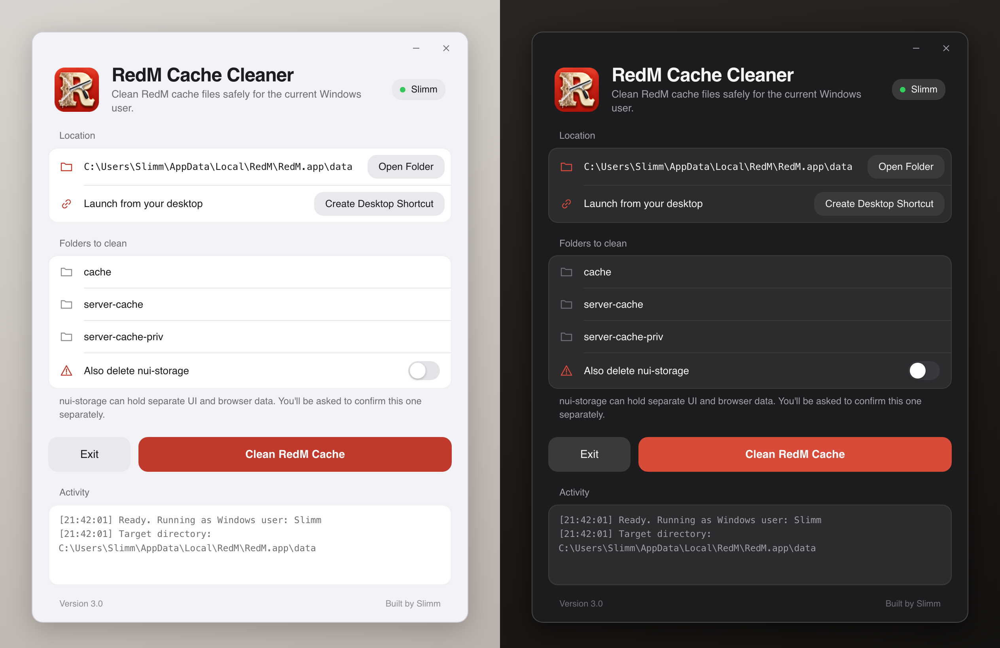
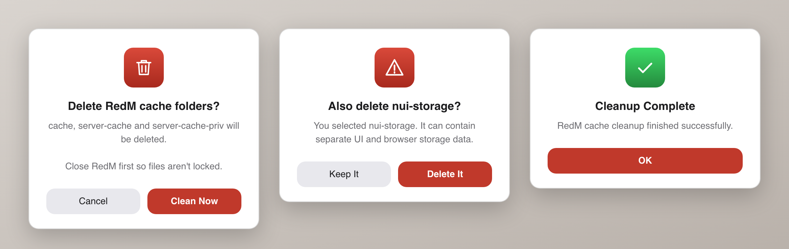
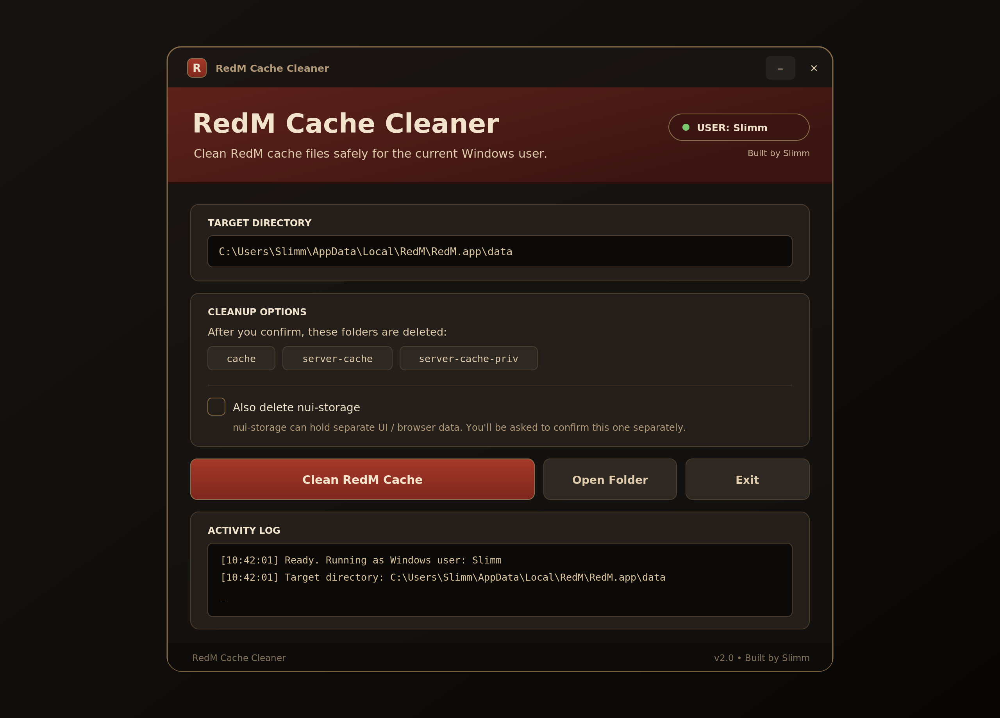

# RedM Cache Cleaner App

<p align="center">
  
</p>

<p align="center">
  <strong>A clean Windows app for clearing RedM cache folders safely for the current Windows user.</strong>
</p>

<p align="center">
  <a href="https://github.com/sdmactech/RedMCacheCleanern/raw/main/dist/RedM%20Cache%20Cleaner%20App.zip"></a>
  
  
</p>

<p align="center">
  
</p>

---

## What's new in 3.0

Version 3.0 is a full visual redesign in a Clean Rounded Style, with a RedM red accent so it still feels like a RedM tool. **What the app cleans hasn't changed.**

**Look**
- Clean grouped layout: **Location**, **Folders to clean** and **Activity**, each in its own rounded panel.
- **Light and dark mode** follow your Windows app theme automatically.
- New app icon: a western-style R getting wiped clean by a squeegee. It shows in the app, on the window and in the taskbar.
- The **nui-storage** option is now an on/off switch.

**Feel**
- The window and dialogs fade and scale in, then leave the same way.
- Buttons press in the moment you click them, and the switch slides.
- The window dims behind any open confirmation.
- If you've turned off animation effects in Windows, the app drops the scaling and sliding and keeps only gentle fades.

**Dialogs**
- Confirmations are centered alerts with a clear icon: trash to confirm a delete, a warning for nui-storage or problems, and a green check when cleanup is done.
- **Esc** cancels and **Enter** confirms. Enter does nothing on the nui-storage delete prompt, so you can't delete it by accident.

<p align="center">
  
</p>

---

## Version history

### 3.0.1: Launcher fix
Microsoft Defender flagged the 3.0 download. 3.0.1 removes the hidden VBS launcher and the Create Desktop Shortcut button, the two parts that looked like malware to antivirus. Launch with **`RedM Cache Cleaner.bat`**. Cleanup is unchanged.

### 3.0: Clean Rounded Style redesign
Covered above. New layout, light and dark mode, motion, and app icon.

### 2.0: Western redesign
2.0 rebuilt the original WinForms window in WPF with a Red Dead inspired theme:
- A frameless window with rounded corners and a leather-and-parchment palette
- A header with a "current user" status pill
- Card-based sections for the target folder, cleanup options and activity log
- Themed confirmation dialogs in place of the gray Windows pop-ups

<p align="center">
  
</p>

### 1.0: Original release
The first version: a simple WinForms window that cleans the RedM cache folders, with the same double confirmation for nui-storage that every version since has kept.

---

## Download

**[Download the v3.0.1 ZIP](https://github.com/sdmactech/RedMCacheCleanern/raw/main/dist/RedM%20Cache%20Cleaner%20App.zip)**

Extract the ZIP before running anything.

---

## What it does

RedM Cache Cleaner helps RedM players clear common local cache folders without digging through `AppData`. It automatically targets the Windows user who launches it.

After you confirm, it deletes:

- `cache`
- `server-cache`
- `server-cache-priv`

There's also an optional switch to delete:

- `nui-storage`

Because `nui-storage` can hold separate UI/browser storage data, the app asks for a **second confirmation** before deleting it.

---

## How to use

1. Double-click **`RedM Cache Cleaner.bat`** to launch the app. A small console window stays open behind the app while it runs; that's normal.
2. Optional: to launch from your desktop, right-click **`RedM Cache Cleaner.bat`** and choose **Show more options > Send to > Desktop (create shortcut)**.
3. Check the RedM data folder shown under **Location**.
4. Click **Clean RedM Cache**.
5. Confirm the cleanup when prompted.
6. If you turned on **Also delete nui-storage**, confirm the second prompt if you still want it deleted.

> Close RedM before cleaning. If RedM is open, Windows may prevent some folders from being deleted.

---

## Included files

| File | Purpose |
| --- | --- |
| `RedM Cache Cleaner.bat` | Double-click launcher for the app. |
| `support_redm_cleaner_Gps1.ps1` | The PowerShell **WPF** app (v3.0.1). Keep it in the same folder as the launcher. |
| `RedM Cache Cleaner.ico` / `.png` | The app icon, used by the window and the taskbar. |
| `support_cleanup_universal.bat` | Universal batch fallback/support script (console-based). |
| `README.txt` | Simple offline instructions included with the ZIP. |

---

## Target folder

The app targets this RedM data folder for the current Windows user:

```text
%LOCALAPPDATA%\RedM\RedM.app\data
```

That normally resolves to something like:

```text
C:\Users\YourWindowsUsername\AppData\Local\RedM\RedM.app\data
```

No hardcoded username is required.

---

## Troubleshooting

### The app does not open

Look at the console window that opens with the app. If something goes wrong, the error shows there.

### Windows blocks the file

If Windows SmartScreen or antivirus asks about the file, only allow it if you trust where you downloaded it from.

If PowerShell blocks the script, right-click the ZIP before extracting, choose **Properties**, check **Unblock** if available, click **Apply**, then extract the ZIP again.

### RedM folder not found

Make sure RedM has been installed and launched at least once for the current Windows user.

---

## Notes for server communities

This utility is meant to be simple enough to send to players who need a quick RedM cache reset. Share the download link and tell players to extract the ZIP before launching the app.

---

## Credit

Created by Slimm
